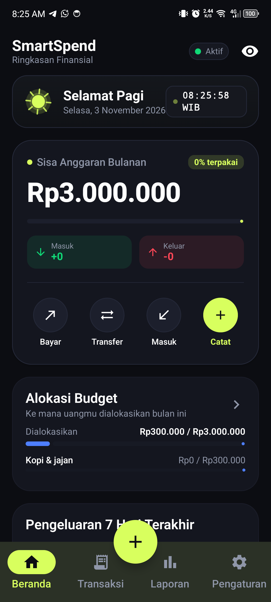
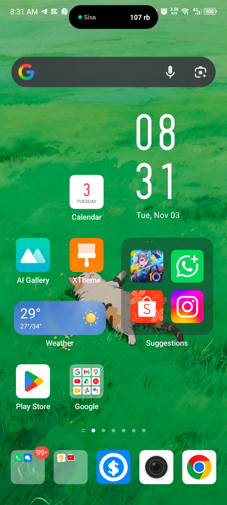
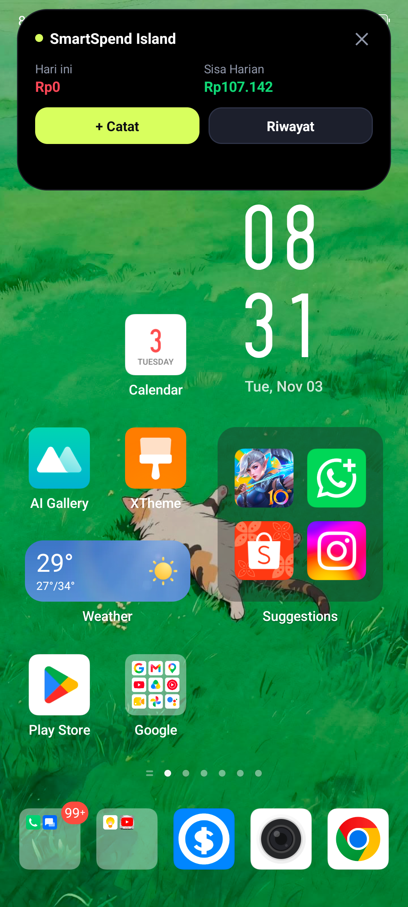
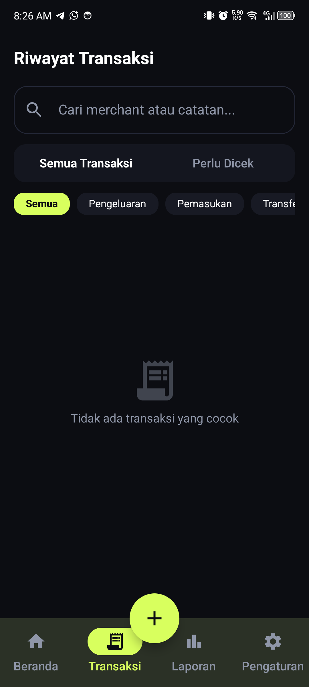
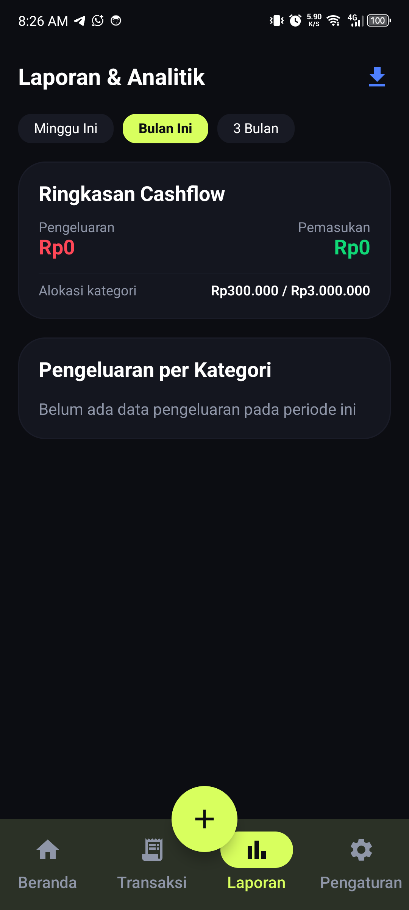

# SmartSpend ⚡
> Aplikasi Pencatat Keuangan Otomatis & Cerdas dengan Dynamic Island dan Notifikasi Realtime.

SmartSpend membantu kamu mengelola keuangan harian secara otomatis tanpa ribet mencatat manual satu per satu. Dilengkapi dengan floating **Dynamic Island** di layar utama dan integrasi notifikasi perbankan serta e-wallet Indonesia.

---

## 📱 Tampilan Aplikasi

<p align="center">
  
  
  
</p>

<p align="center">
  
  
</p>

---

## ✨ Fitur-Fitur Unggulan

### 📩 1. Catat Transaksi Otomatis dari Notifikasi
- **Tanpa Perlu Buka Aplikasi**: Setiap kamu selesai belanja, bayar QRIS, atau transfer uang, SmartSpend langsung mendeteksi notifikasi HP dan mencatat nominal serta nama tokonya secara instan.
- **Bebas Dobel Catat**: Sistem pintar otomatis mengenali transaksi yang sama agar tidak tercatat dua kali.
- **Deteksi Otomatis Bank & E-Wallet**: Mendukung notifikasi transaksi dari m-Banking dan dompet digital terpopuler di Indonesia.

### 🏝️ 2. Dynamic Island di Layar Utama (Home Screen)
- **Informasi Sisa Uang Harian**: Menempel pas di punch-hole kamera HP kamu untuk memantau sisa uang yang aman dibelanjakan hari ini.
- **Tombol Cepat Catat Pengeluaran**: Ketuk pulau untuk membuka menu cepat catat uang keluar atau cek riwayat mutasi dalam 1 detik.
- **Otomatis Menyesuaikan Layar**: Hanya muncul di layar beranda (Home Screen). Begitu kamu membuka aplikasi lain (seperti WhatsApp, Shopee, YouTube, atau Game), pulau langsung otomatis menghilang agar layar tetap bersih dan tidak terhalang.
- **Tutup Otomatis (Auto-Collapse)**: Tampilan menu pulau akan otomatis mengecil kembali setelah 10 detik jika tidak disentuh.

### 🏦 3. Dukungan Lengkap Bank & E-Wallet Populer
Sudah dilengkapi kartu dan identitas visual resmi untuk berbagai bank dan e-wallet Indonesia:
- **Bank**: BCA, Mandiri (Livin'), BRI (BRImo), BNI, BSI (Bank Syariah Indonesia), CIMB Niaga (OCTO), Bank Jago, SeaBank.
- **E-Wallet**: GoPay, DANA, OVO, ShopeePay, LinkAja.
- **Tunai**: Dompet uang fisik untuk transaksi uang kas.

### 📊 4. Pantau Anggaran & Batas Belanja Harian
- **Kategori Anggaran Bulanan**: Bagi budget untuk Makanan, Transportasi, Belanja, Tagihan, dan Hiburan.
- **Rekomendasi Sisa Uang Harian**: Hitung otomatis berapa uang yang boleh kamu habiskan hari ini agar gaji cukup sampai akhir bulan.
- **Grafik Arus Kas (Cashflow)**: Lihat perbandingan uang masuk vs uang keluar secara jelas.

### 📱 5. Widget Layar Depan (Home Screen Widget)
- Pasang widget praktis langsung di layar HP kamu untuk melihat sisa saldo rekening dan progres anggaran bulanan tanpa harus membuka aplikasi.

### 🔒 6. 100% Privat, Aman, dan Offline
- Semua riwayat dan saldo keuangan tersimpan aman di perangkat kamu sendiri.
- Tanpa perlu login akun perbankan, tanpa simpan password, dan data tidak pernah diunggah ke server pihak ketiga.

---

## 🚀 Cara Menjalankan Aplikasi

1. Clone repositori ini:
   ```bash
   git clone https://github.com/fadhlanayti/smartspendApp.git
   ```
2. Buka folder proyek di **Android Studio**.
3. Hubungkan perangkat Android (Android 8.0 ke atas) atau emulator.
4. Klik **Run** atau jalankan perintah:
   ```bash
   ./gradlew assembleDebug
   ```
5. Berikan izin **Akses Notifikasi** dan **Layanan Aksesibilitas** saat pertama kali membuka aplikasi agar fitur otomatisasi dapat bekerja.

---

## 📄 Lisensi
SmartSpend dirilis di bawah lisensi open source.
